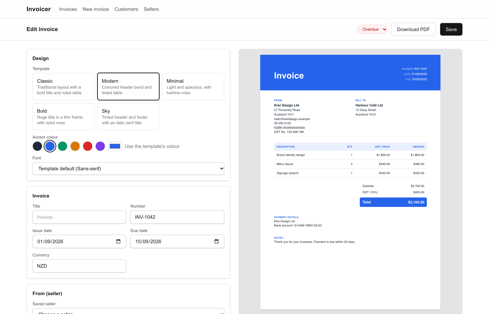
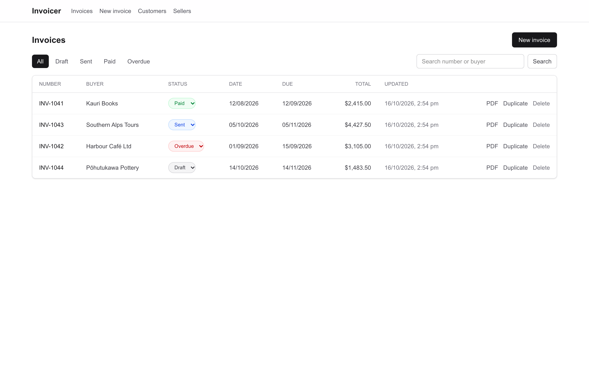
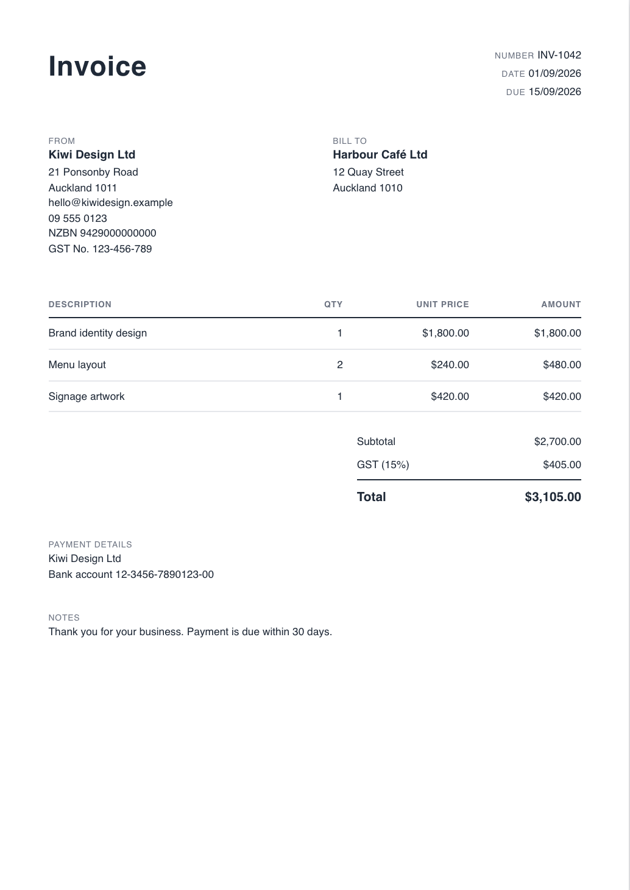
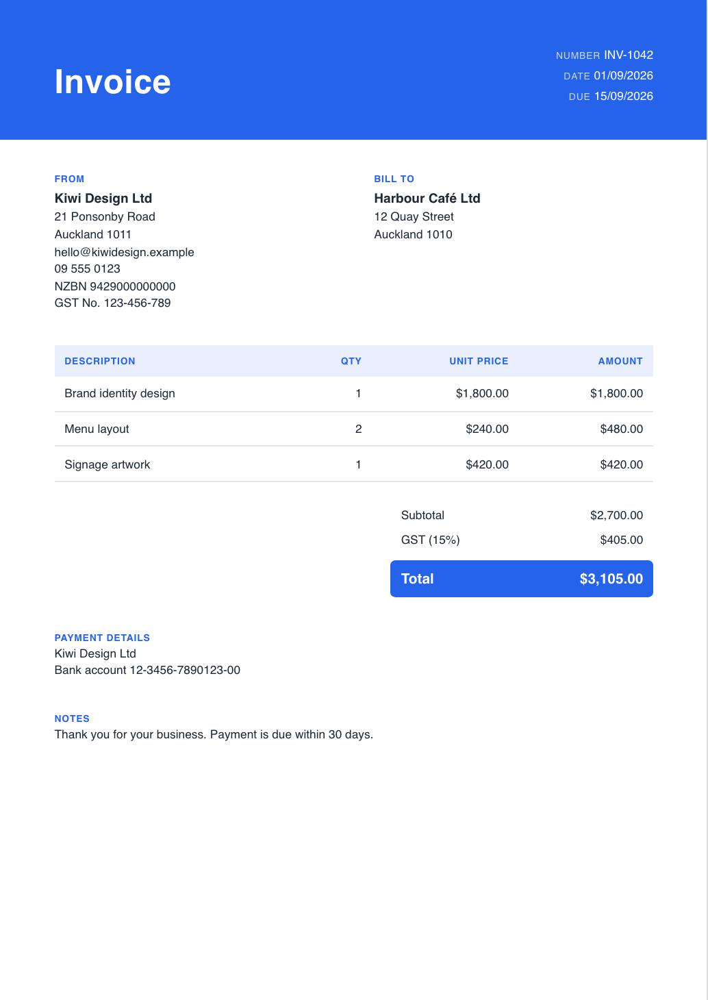
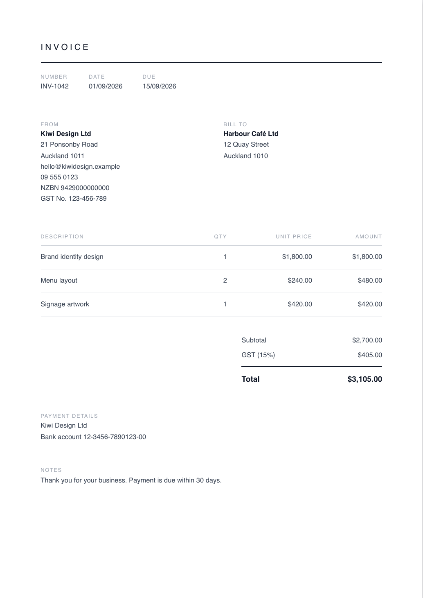
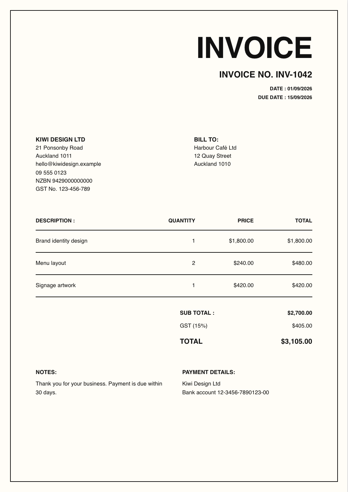
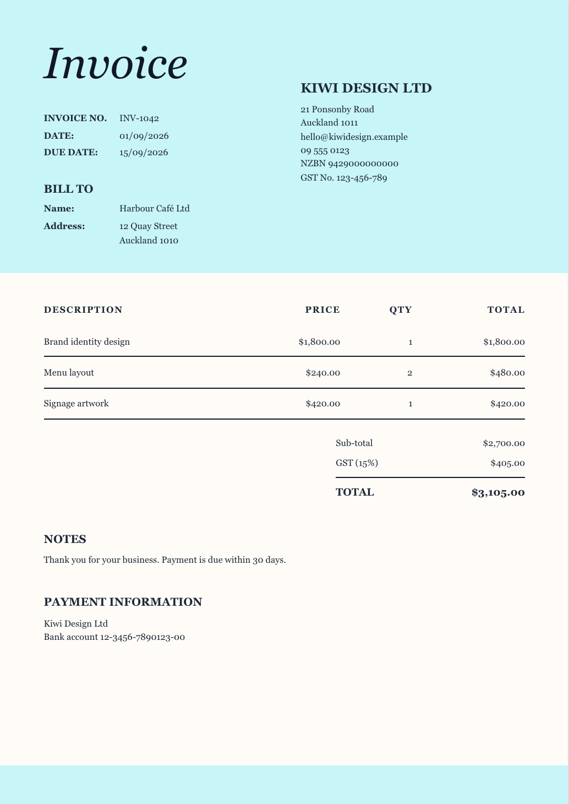

# invoicer

An invoice generator: pick a template, enter the details, watch the invoice update live, and
download it as a PDF. Built with Next.js and TypeScript for New Zealand use (NZD, 15% GST). It runs
locally in Docker and has no login, so it is meant for one person on one machine.





## Features

- **Five templates** (Classic, Modern, Minimal, Bold, Sky), each with a choice of accent colour and
  font. The preview and the PDF are rendered from the same template, so what you see is what you
  get.
- **Saved invoices** with draft, sent and paid status. A sent invoice past its due date shows as
  overdue. The list can be filtered by status and searched by number or buyer.
- **Reusable sellers and customers.** Keep several sellers (for example one per business), mark one
  as the default, and pick sellers and customers when you write an invoice.
- **Snapshots.** Saving an invoice stores a full copy of it, so editing or deleting a seller or
  customer never changes an invoice you already sent.
- **GST handling** for prices entered with or without GST, calculated in integer cents.

<table>
  <tr>
    <td></td>
    <td></td>
    <td></td>
  </tr>
  <tr>
    <td></td>
    <td></td>
    <td></td>
  </tr>
</table>

## Run it with Docker

Needs only Docker.

```bash
docker compose up --build
```

Then open http://localhost:1333. This starts PostgreSQL, applies the database migrations, and runs
the app. The data lives in a Docker volume (`pgdata`) and survives restarts. Stop with
`docker compose down`; add `-v` to also delete the data.

The first build downloads Chromium and its fonts (the image is about 2 GB), so it takes a few
minutes. The app and the database are published on `127.0.0.1` only.

## Develop

Needs Node.js 22+ and Docker (for PostgreSQL).

```bash
npm install                       # also generates the Prisma client
cp .env.example .env              # database connection strings
npm run db:up                     # start PostgreSQL only (localhost:5433)
npm run db:migrate                # create the tables
npx playwright install chromium   # one-off: the browser used to render PDFs
npm run dev                       # http://localhost:1333
```

Use either `npm run dev` or the full Docker stack, not both: they share port 1333.

| Command                    | What it does                                                    |
| -------------------------- | --------------------------------------------------------------- |
| `npm run check`            | Everything below, in order. Run it before committing.           |
| `npm test`                 | Unit tests (Vitest). No database needed.                        |
| `npm run test:integration` | Database tests against the `invoicer_test` database.            |
| `npm run test:e2e`         | Browser tests (Playwright) against a production build.          |
| `npm run screenshots`      | Regenerates the images in `docs/images` with made-up demo data. |
| `npm run lint`             | ESLint.                                                         |
| `npm run typecheck`        | TypeScript.                                                     |
| `npm run format`           | Prettier.                                                       |
| `npm run db:studio`        | Browse the database.                                            |
| `npm run db:down`          | Stop PostgreSQL (the data stays in its Docker volume).          |

The integration and browser tests delete every row in the **test** database, and refuse to run
unless its name ends in `_test`. The browser tests build into `.next-e2e`, so they can run while the
dev server is up. A GitHub Actions workflow with the same checks (minus the browser tests) is in
`.github/workflows/ci.yml`.

## Design notes

- Only the seller name and buyer name are required; every other field is optional.
- Invoice numbers are free-form strings entered manually (no auto-generation, no uniqueness check).
- Amounts are stored as integer cents; GST rates as basis points (1500 = 15%).
- A line item needs both quantity and unit price to count towards totals; incomplete lines are still
  shown on the invoice, without an amount.
- GST is calculated once on the sum of GST-applicable lines, not per line.
- Each invoice picks one of five templates, an accent colour and a font (each falls back to the
  template's own default). All of it is part of the saved invoice, so changing a template later
  never alters an old invoice's look.
- Invoice status is draft, sent or paid. Overdue is worked out (sent and past the due date), not
  stored, so it can never go stale.
- Saving an invoice stores a full snapshot of it (seller, buyer, lines, tax settings, design) in
  PostgreSQL.
- The live preview and the PDF come from the same template component (`src/templates`). The PDF is
  rendered on the server with headless Chromium, with scripts and all network access disabled.
- The Docker image runs Chromium without its sandbox (Docker's default security profile blocks
  it); the container is the isolation, and the page it renders is the app's own escaped HTML.
- There is no authentication. Run it locally only; do not expose it to the public internet.

More detail is in [docs/](docs): the requirements, the tech stack and the reasons behind it, and
beginner-friendly guides to TypeScript and Next.js, Zod, and Prisma and the database in
[docs/learn](docs/learn).

## Possible next steps

Not planned, but natural: editing saved customers, a logo, more templates, recurring invoices,
emailing an invoice, and a login if it were ever hosted for more than one person.
